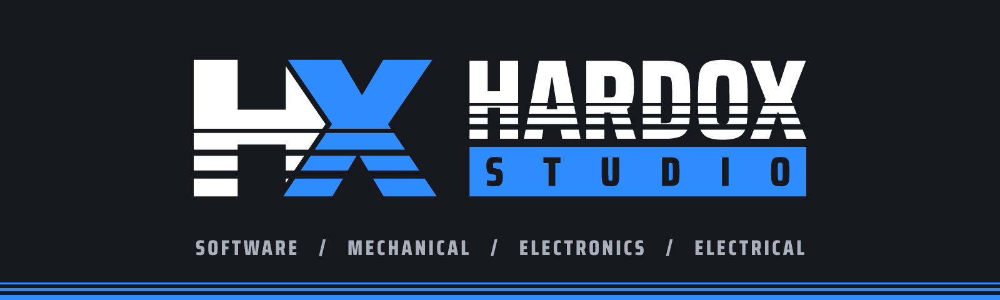

**A development and innovation studio. We build solutions across software, mechanical, electronics and electrical work.**

---

## What we work on

| | |
|---|---|
| **Software** | Tools, add-ons and applications |
| **Mechanical** | Design and 3D printing |
| **Electronics** | Circuits and embedded projects |
| **Electrical** | Electrical systems |

## Featured project

### [Send to Creality](https://github.com/HARDOX-STUDIO/blender-send-to-creality)

A one-button Blender add-on that merges your parts into one printable solid, sets the height, checks the mesh and sends it to Creality Print.

